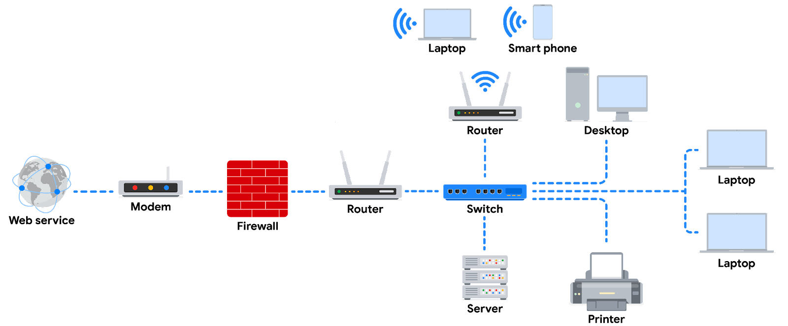
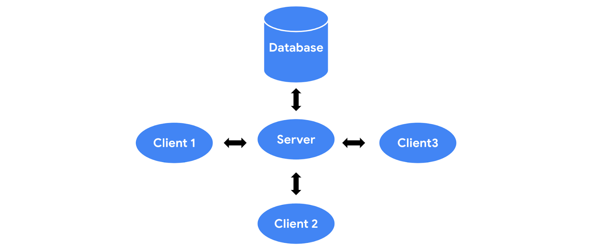
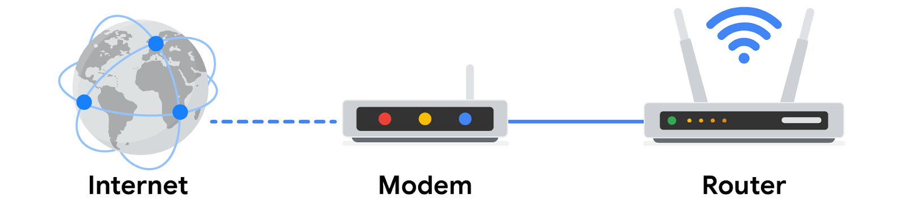
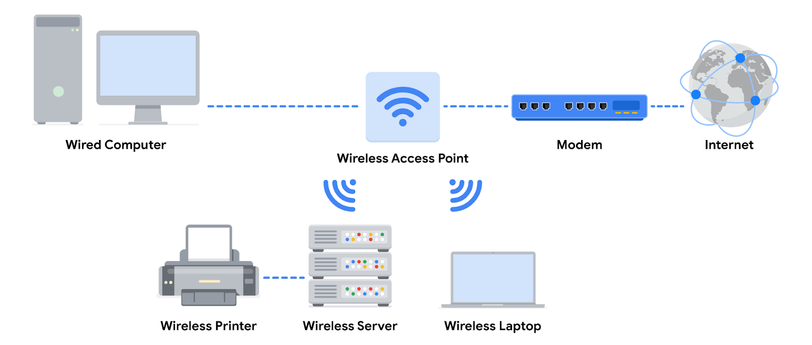
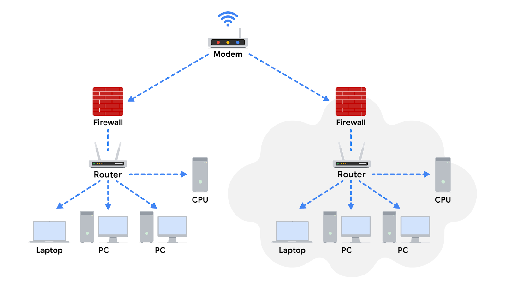
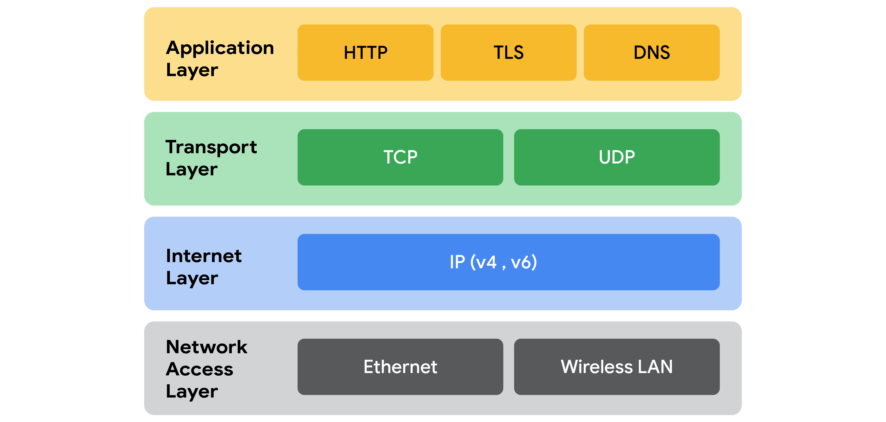

# Connect and Protect: Networks and Network Security

Network: A Network is a connected devices

**Neywork devices:** Network devices maintain information and services for users of a network. These devices connect over wired and wireless connections. After establishing a connection to the network, the devices send data packets. The data packets provide information about the source and the destination of the data.

The network is the overall infrastructure that allows devices to communicate with each other. Network devices are specialized vehicles like routers and switches that manage what is being sent and received over the network.

**Note:** In this diagram, a `router` connects to the internet through a `modem`, which is provided by your internet service provider (ISP). The firewall is a security device that monitors incoming and outgoing traffic on your network. The router then directs traffic to the devices on your home network, which can include computers, laptops, smartphones, tablets, printers, and other devices. You can imagine here that the `server` is a file server. All devices on this network can access the files in this server. This diagram also includes a `switch` which is an optional device that can be used to connect more devices to your network by providing additional ports and Ethernet connections. Additionally, there are 2 routers connected to the switch here for load balancing purposes which will improve the performance of the network.

**Devices and desktop computers:** Each device and desktop computer has a unique MAC address and IP address, which identify it on the network.

**Firewalls:** A firewall is a network security device that monitors traffic to or from your network. It is like your first line of defense. Firewalls can also restrict specific incoming and outgoing network traffic. The organization configures the security rules of the firewall.

**Servers:** `Servers` provide information and services for devices like computers, smart home devices, and smartphones on the network. The devices that connect to a server are called clients. The following graphic outlines this model, which is called the client-server model. In this model, clients send requests to the server for information and services. The server performs the requests for the clients. Common examples include DNS servers that perform domain name lookups for internet sites, file servers that store and retrieve files from a database, and corporate mail servers that organize mail for a company.

**Hubs:** A `hub` is a device that provides a common point of connection for all devices directly connected to it. Hubs additionally repeat all information out to all ports. From a security perspective, this makes hubs vulnerable to eavesdropping.

**Switch:** A `switch` forwards packets between devices directly connected to it. They analyze the destination address of each data packet and send it to the intended device. Switches maintain a MAC address table that matches MAC addresses of devices on the network to port numbers on the switch and forwards incoming data packets according to the destination MAC address. Switches are a part of the data link layer in the TCP/IP model.

**Routers:** Routers connect networks and direct traffic, based on the IP address of the destination network. Routers allow devices on different networks to communicate with each other. In the TCP/IP model, routers are a part of the network layer. The IP address of the destination network is contained in the IP header. The router reads the IP header information and forwards the packet to the next router on the path to the destination. This continues until the packet reaches the destination network. Routers can also include a firewall feature that allows or blocks incoming traffic based on information in the transmission. This stops malicious traffic from entering the private network and damaging the local area network.

**Modems:** usually connect your home or office with an internet service provider (ISP). ISPs provide internet connectivity via telephone lines, coaxial cables, or fiber optic cables. Modems receive transmissions or digital signals from the internet and convert them into a digital format compatible with the physical connection provided by your ISP. Usually, modems connect to a router that takes the decoded transmissions and sends them on to the local network.

**Note:** Enterprise networks used by large organizations to connect their users and devices often use other broadband technologies to handle high-volume traffic, instead of using a modem.

A **wireless access point** sends and receives digital signals over radio waves creating a wireless network. Devices with wireless adapters connect to the access point using Wi-Fi. Wi-Fi refers to a set of standards that are used by network devices to communicate wirelessly. Wireless access points and the devices connected to them use Wi-Fi protocols to send data through radio waves where they are sent to routers and switches and directed along the path to their final destination.

**Network diagram:** Network diagrams use small representative graphics to portray each network device and dotted lines to show how each device connects to the other.

## Network Communications

Data: A basic unit of information that travels from one device to another within a network.
Bandwidth: The amount of data a devices receives every second.
Speed: The rate at which data packets are received or downloaded.
Packet sniffing: The practice of capturing and inspecting data packets across a network.

**TCP/IP model:** The TCP/IP model is a framework used to visualize how data is organized and transmitted across a network.The TCP/IP model has four layers: the network access layer, internet layer, transport layer, and application layer.

1. **Network access layer:** The network access layer, sometimes called the data link layer, deals with the creation of data packets and their transmission across a network. This layer corresponds to the physical hardware involved in network transmission. Hubs, modems, cables, and wiring are all considered part of this layer.

1. **Internet layer:** The internet layer, sometimes referred to as the network layer, is responsible for ensuring the delivery to the destination host, which potentially resides on a different network. It ensures IP addresses are attached to data packets to indicate the location of the sender and receiver. The internet layer also determines which protocol is responsible for delivering the data packets and ensures the delivery to the destination host. Here are some of the common protocols that operate at the internet layer:

- **Internet Protocol (IP).** IP sends the data packets to the correct destination and relies on the Transmission Control Protocol/User Datagram Protocol (TCP/UDP) to deliver them to the corresponding service. IP packets allow communication between two networks. They are routed from the sending network to the receiving network. TCP in particular retransmits any data that is lost or corrupt.

- **Internet Control Message Protocol (ICMP).** The ICMP shares error information and status updates of data packets. This is useful for detecting and troubleshooting network errors. The ICMP reports information about packets that were dropped or that disappeared in transit, issues with network connectivity, and packets redirected to other routers.

1. **Transport layer** The transport layer is responsible for delivering data between two systems or networks and includes protocols to control the flow of traffic across a network. TCP and UDP are the two transport protocols that occur at this layer.

- **Transmission Control Protocol:** The Transmission Control Protocol (TCP) is an internet communication protocol that allows two devices to form a connection and stream data. It ensures that data is reliably transmitted to the destination service. TCP contains the port number of the intended destination service, which resides in the TCP header of a TCP/IP packet.

- **User Datagram Protocol** The User Datagram Protocol (UDP) is a connectionless protocol that does not establish a connection between devices before transmissions. It is used by applications that are not concerned with the reliability of the transmission. Data sent over UDP is not tracked as extensively as data sent using TCP. Because UDP does not establish network connections, it is used mostly for performance sensitive applications that operate in real time, such as video streaming.

1. The **application layer** in the TCP/IP model is similar to the application, presentation, and session layers of the OSI model. The application layer is responsible for making network requests or responding to requests. This layer defines which internet services and applications any user can access. Protocols in the application layer determine how the data packets will interact with receiving devices. Some common protocols used on this layer are:

- Hypertext transfer protocol (HTTP)
- Simple mail transfer protocol (SMTP)
- Secure shell (SSH)
- File transfer protocol (FTP)
- Domain name system (DNS)

Application layer protocols rely on underlying layers to transfer the data across the network.

